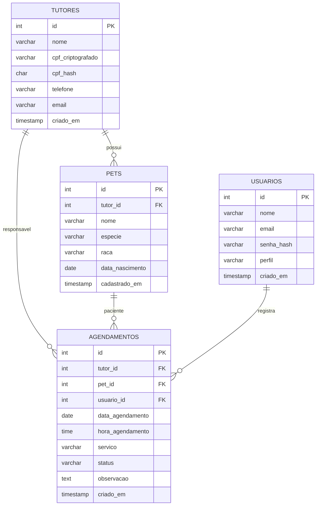

# Sistema de gestão de uma clínica veterinária

Aplicação web em PHP para: organizar tutores, pets e consultas de uma clínica veterinária.

## Tecnologia/Estrutura u
ada:

- PHP 8.5.9
- Composer 2.10.2
- PostgreSQL

O projeto usa arquitetura MVC, PostgreSQL como Banco de dados e PDO, mantém o CPF criptografado no banco e precisa de autenticação para acessar as funcionalidades.

## Funcionalidades

- Login por e-mail e senha, com validação de falhas, proteção CSRF e sessão expirada após 15 minutos de inatividade.
- Painel com identificação do usuário, resumo da clínica e acesso a tutores, pets e agendamentos; logout pelo menu.
- Cadastro e busca de tutores por nome, e-mail ou telefone, além de edição dos dados. O CPF fica criptografado, é verificado por hash com chave para impedir duplicidade e não é exibido na listagem.
- Cadastro de pets com vínculo obrigatório a um tutor e listagem com dados do responsável.
- Cadastro e listagem cronológica de consultas com dados de tutor e pet; edição da data e do horário.
- Validação de que o pet selecionado pertence ao tutor escolhido, inclusive no banco de dados.

## Requisitos funcionais

| Código | Requisito |
|---|---|
| RF-01 | Autenticar usuários e informar falhas de login; expirar a sessão após 15 minutos sem atividade. |
| RF-02 | Encerrar a sessão por meio do logout. |
| RF-03 | Exibir no painel o nome do usuário autenticado e atalhos para os recursos do sistema. |
| RF-04 | Cadastrar e editar tutores, armazenando o CPF criptografado. |
| RF-05 | Pesquisar tutores por nome, e-mail ou telefone e atualizar a listagem com os resultados. |
| RF-06 | Cadastrar pets associados a um tutor e consultar a listagem. |
| RF-07 | Cadastrar agendamentos e exibi-los por data, com os dados do tutor e do pet. |
| RF-08 | Atualizar a data e o horário de um agendamento existente. |

## Requisitos não funcionais

| Código | Requisito |
|---|---|
| RNF-01 |Aplicação organizada em MVC, com autoload PSR-4.|
| RNF-02 |Persistência relacional em PostgreSQL e comandos SQL parametrizados com PDO.
| RNF-03 |Proteção contra XSS por escape da saída HTML e contra CSRF nos formulários.
| RNF-04 |CPF criptografado e hash com chave para evitar duplicidades.
| RNF-05 |Chaves estrangeiras para relacionar pets e tutores, consultas e usuários.

## Diagrama entidade-relacionamento

